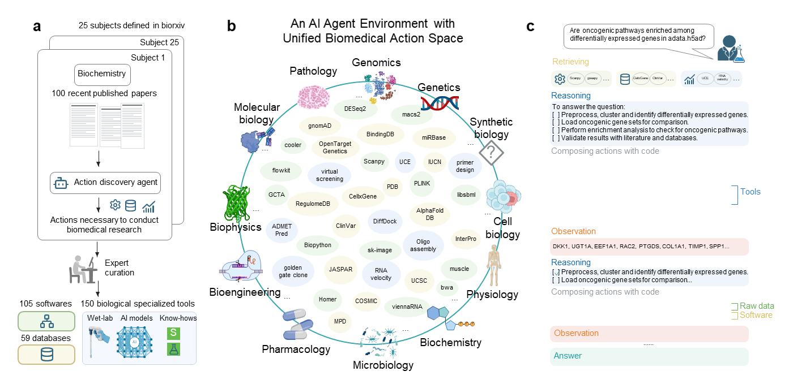
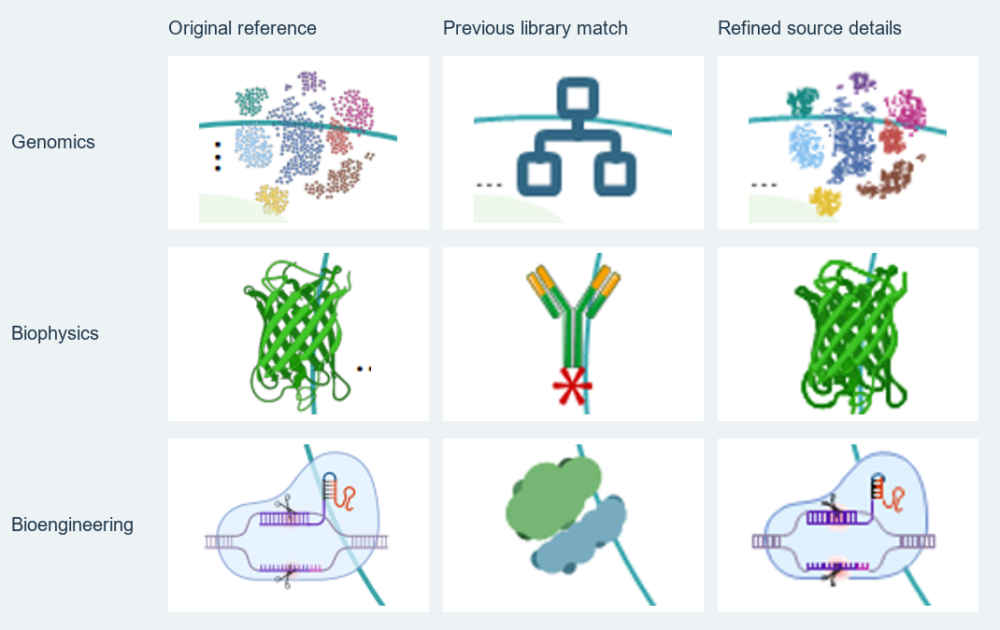
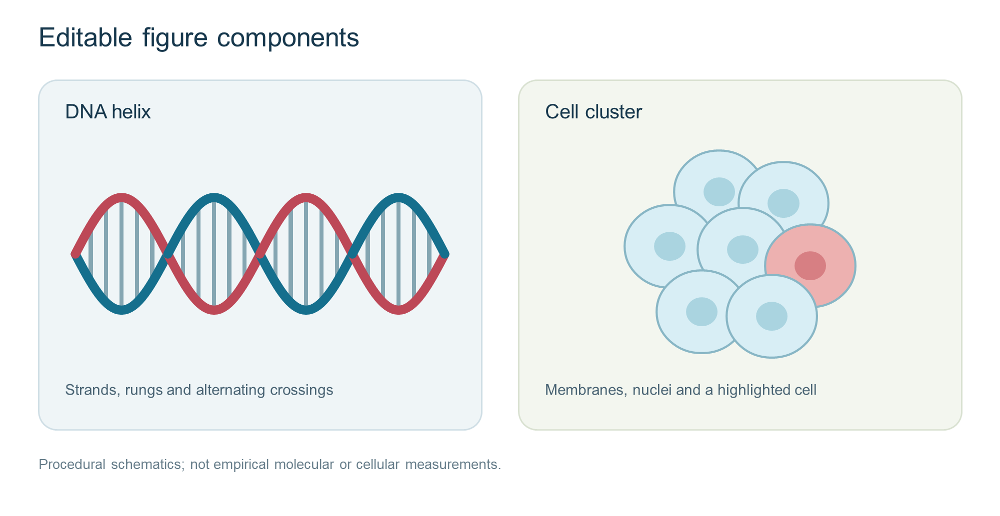

# fig-cos

**Reference-faithful scientific figures → editable SVG + native PowerPoint.**

[简体中文](README.zh-CN.md) · [Quick start](#quick-start) · [Agent integration](docs/AGENTS.md) · [Gallery & credits](docs/GALLERY.md) · [Quality standard](docs/QUALITY.md)


fig-cos packages a tested figure-reconstruction workflow, local vector/PPTX tooling, and an Agent Skill. The calling agent supplies visual inspection and planning; deterministic scripts handle tracing, assembly and export. **No LLM API client, paid backend or model key is required by the drawing engine.**

The default is **Previous local tracing**: trace individual components from the reference, retain their appearance and structure, and rebuild text, frames and arrows separately. A blurry input does not silently trigger a different protein fold, generic replacement icon or AI redraw.

## See the results

### A complex biomedical figure, reconstructed as editable objects



Historical, inspected Microsoft PowerPoint rendering: **127 live text objects, 3,978 native objects, zero embedded raster pictures**. Scientific pictograms were locally recovered/traced from the reference; some generic UI icons and paper thumbnails were replaced with schematics. This is an approximate reconstruction, not a pixel-identical recovery. Adapted from Huang et al., *Biomni*, Figure 1, [bioRxiv 2025](https://doi.org/10.1101/2025.05.30.656746), **CC BY 4.0**. Changes and individual asset credits: [gallery](docs/GALLERY.md).

### Source shape matters more than a matching category



The middle column is an earlier library substitution, shown as a comparison rather than a recommended result. Source-derived contours preserve the visible protein and biological assembly more closely. Same Biomni source and attribution as above; modified comparison, with additional icon credits in the gallery.

### Design mode: native components from a reproducible scene



Original procedural schematics, not empirical molecular/cellular measurements. [Scene JSON](examples/procedural/scene.json) · [SVG](examples/procedural/editable.svg) · [PPTX](examples/procedural/editable.pptx). Reproduce with `fig-cos demo`.

## Quick start

```bash
git clone https://github.com/irrrricardo/fig-cos.git
cd fig-cos
python -m venv .venv
# Activate .venv for your shell, then:
python -m pip install .
fig-cos doctor
fig-cos demo --output-dir outputs/demo
```

The demo produces an editable SVG, native PPTX, SVG preview, scene and provenance. `doctor` checks imports and Cairo availability; it does not certify that desktop PowerPoint is installed or that a figure has passed visual review.

Windows may need a Cairo runtime on PATH for CairoSVG. On Debian/Ubuntu, install `libcairo2` and a suitable font package; on macOS, a Cairo installation may be needed. Follow [CairoSVG installation guidance](https://cairosvg.org/documentation/) for the host. Fonts affect layout: use fonts available on the rendering machine and compare the result.

### Trace an inspected text-free component

```bash
fig-cos trace --input-image crop-2x.png --original-size 132 175 --text-free --preset detail --output-dir outputs/component
fig-cos compose --scene scene.json --output-dir outputs/figure --export-pptx
fig-cos export --input-svg approved.svg --output-dir outputs/export
```

For reconstruction, crop and record component positions, prepare a text manifest, assemble components at their reference coordinates, and inspect both SVG and PPT. Tracing the whole screenshot does **not** recover editable lettering or semantic parts. All output directories must be new. See the [workflow](docs/WORKFLOW.md) and [CLI](docs/CLI.md).

## Use with another agent or model

```bash
fig-cos install-skill --target /path/to/your/agent/skills/fig-cos
```

Use a new target directory; the installer never overwrites an existing skill. The portable skill is [here](src/fig_cos/skills/fig-cos/SKILL.md). A client needs file access, Python execution, and visual inspection (or an explicit user-provided layout/text manifest). `agents/openai.yaml` is optional host metadata. A model with function calling can invoke the CLI through its own tool runner. **An MCP server is not included in v0.1.0.**

The public skill identifier is `fig-cos`, following the hyphenated Agent Skills format. The Python import remains `fig_cos`; an existing private `$fig_cos` installation need not be renamed.

## Capabilities and boundaries

| Capability | Status |
| --- | --- |
| Local color-contour tracing | Implemented; approximate, no new source information |
| Live text, shapes, nested native PPT groups | Implemented |
| Supported linear gradients | Implemented; limited SVG subset, unsupported forms fail explicitly |
| Original PDF region recovery | Optional `pdf` extra; complex clipping/transparency needs inspection |
| Bioicons / Reactome / SciDraw candidates | Implemented connectors; network and per-asset licenses apply |
| NIH BioArt | Entry/preview resolver; no universal SVG downloader |
| Actual PowerPoint rendering | Windows + desktop PowerPoint + `powerpoint` extra |
| Automatic semantic segmentation / molecule identification | Not implemented |
| AI generation / super-resolution / structural restoration | Not bundled; optional host tools and explicit user request |

Install optional features with `python -m pip install ".[powerpoint]"` or `python -m pip install ".[pdf]"`. The **PDF extra uses PyMuPDF (AGPL/commercial)**; review its terms before choosing it. Base image tracing and PPTX export do not need that extra. See [compatibility](docs/COMPATIBILITY.md) and [third-party notices](THIRD_PARTY_NOTICES.md).

## Development

```bash
python -m pip install -e ".[dev]"
python tools/validate_release.py
python -m unittest discover -s tests -v
python -m build
```

CI exercises installation, tracing, SVG/PPTX generation, portable skill resources and layout protection on Windows and Linux. A passing export test is not a scientific or visual acceptance certificate. See [CONTRIBUTING](CONTRIBUTING.md).

## License and acknowledgement

Original code is MIT. Upstream MIT files retain their original license and hashes; downloaded icons and paper-derived documentation images retain their own terms. **The MIT badge does not relicense those assets or dependencies.** See [THIRD_PARTY_NOTICES.md](THIRD_PARTY_NOTICES.md).

The native geometry/export pipeline includes public MIT code from [yrui-cmd/Cell](https://github.com/yrui-cmd/Cell), commit `2465e0adb0537c47538299dfea4de44e265a1055`. fig-cos does not reproduce or connect to a proprietary Cell server.
