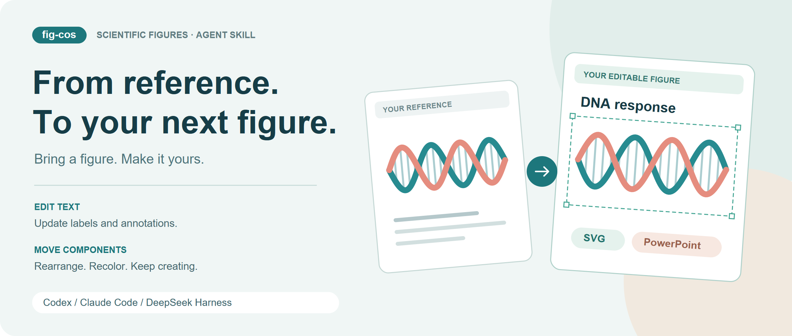
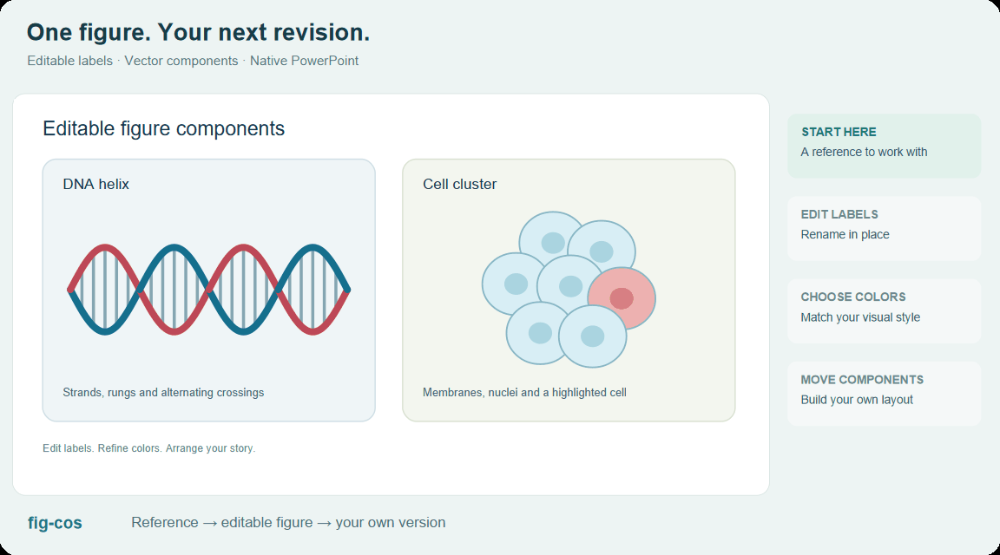

# fig-cos

### Turn a reference into a figure you can make your own.

Bring scientific illustrations, mechanism diagrams and graphical abstracts to your agent. Get **editable SVG and native PowerPoint**—ready for new labels, colors and layouts.

[简体中文](README.zh-CN.md) · [Install the Skill](#quick-start--install-the-skill) · [Download](https://github.com/irrrricardo/fig-cos/releases) · [See it in action](#see-it-in-action)



**One reference. One request. A figure you can keep working on.**

fig-cos is an **Agent Skill** for scientific figures, available for **Codex, Claude Code and DeepSeek Harness**. Reconstruct an existing image, refine a diagram for a presentation, or build a new schematic with your agent.

```text
Use fig-cos to recreate this reference as an editable PowerPoint figure.
Keep its structure and layout, make the labels editable, and group the components.
```

## See it in action

| What you want to do | What fig-cos helps you create |
| --- | --- |
| Recreate a complex scientific illustration | A structured figure with editable labels, components and layout |
| Bring a screenshot into your presentation | SVG / PPTX you can relabel, recolor and rearrange |
| Develop a mechanism diagram or graphical abstract | A composition of scientific artwork, text, arrows and frames |
| Add scientific elements to a figure | Vector assets from Bioicons, Reactome, SciDraw and other libraries |

### 01 · Complex figures, ready for the next revision

Multi-panel layouts, dense labels, biological artwork and workflow arrows—reconstructed as text and components you can continue working with.


**127 editable text objects · 25 graphic groups · SVG + native PPTX**

Case study: Huang et al., [*Biomni*, Figure 1](https://doi.org/10.1101/2025.05.30.656746), CC BY 4.0, reconstructed with fig-cos. [Artwork credits](docs/GALLERY.md).

### 02 · Edit the labels. Pick your colors. Move things around.

Rename a study group, change the highlight palette, and reposition the cell component. Keep the figure moving with your manuscript or presentation.



[Open the edited SVG](examples/editing/after.svg) · [Download the editable PPTX](examples/editing/after.pptx) · [Explore the example](examples/editing/README.md)

### 03 · Start a new figure from an idea

A DNA helix, a cell cluster, a process to explain: describe the story and let your agent organize the text, geometry and scientific components into a figure.


[Scene JSON](examples/procedural/scene.json) · [SVG](examples/procedural/editable.svg) · [PowerPoint](examples/procedural/editable.pptx)

## From reference to your next figure

**1. Bring a reference.** Attach an image or PDF and say what you want to keep.  
**2. Describe the task.** Recreate the figure, refine one part, or develop a new design.  
**3. Keep creating.** Open the SVG/PPTX and continue editing the text, components and layout.

## Quick start — install the Skill

Clone the repository:

```bash
git clone https://github.com/irrrricardo/fig-cos.git
cd fig-cos
```

### Codex

```bash
python tools/install_skill.py --agent codex
```

Attach your reference and invoke:

```text
$fig-cos Recreate this scientific figure as editable SVG and PowerPoint.
```

You can also ask Codex's Skill Installer directly:

```text
$skill-installer install https://github.com/irrrricardo/fig-cos/tree/main/skills/fig-cos
```

### Claude Code

```bash
python tools/install_skill.py --agent claude
```

Then attach the image and use:

```text
/fig-cos Recreate this figure with its structure and layout, and deliver an editable PPTX.
```

### DeepSeek Harness

```bash
python tools/install_skill.py --agent deepseek-harness
```

Attach your image and ask:

```text
Load the fig-cos Skill and reconstruct this reference as editable SVG and PowerPoint.
```

### Skill locations

| Agent | User installation | Project installation |
| --- | --- | --- |
| Codex | `~/.agents/skills/fig-cos/` | `<project>/.agents/skills/fig-cos/` |
| Claude Code | `~/.claude/skills/fig-cos/` | `<project>/.claude/skills/fig-cos/` |
| DeepSeek Harness | `~/.dsh/skills/fig-cos/` | `<project>/.dsh/skills/fig-cos/` |

For project installation, add `--scope project --project-dir /your/project`. Or download the Skill archive from [Releases](https://github.com/irrrricardo/fig-cos/releases) and copy the complete `fig-cos` folder to your host's Skill root.

Discovery, setup and runtime details: [Agent guide](docs/AGENTS.md) · [Compatibility](docs/COMPATIBILITY.md).

## Built for the next edit

- **Live text:** update titles, labels and annotations directly.
- **Grouped components:** move a module or work on its individual paths.
- **Reference-led layout:** build from the appearance and structure you chose.
- **Useful handoff:** take the SVG, PowerPoint, preview and scene with you.
- **Local tracing and export:** your agent coordinates the workflow from reference to delivery.

[The Skill](skills/fig-cos/SKILL.md) · [Workflow](docs/WORKFLOW.md) · [Quality standard](docs/QUALITY.md) · [Helper CLI](docs/CLI.md) · [Contributing](CONTRIBUTING.md)

## Credits and license

Project code is MIT; example artwork and library assets retain their recorded licenses. Native geometry/export includes public MIT code from [yrui-cmd/Cell](https://github.com/yrui-cmd/Cell). [Third-party notices](THIRD_PARTY_NOTICES.md) · [Gallery credits](docs/GALLERY.md).
